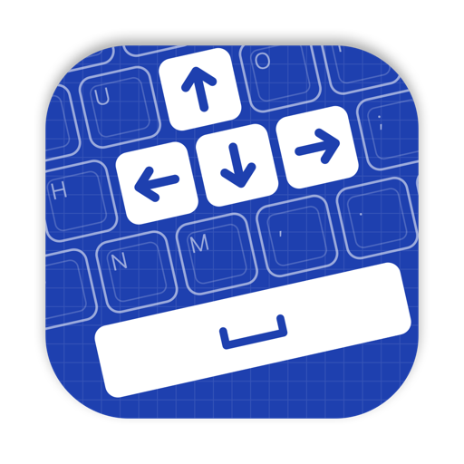

<p align="center">
  
</p>

<h1 align="center">TouchCursor for macOS</h1>

<p align="center">
  Use the space bar as a modifier key to move the cursor and edit text without leaving the home row.
</p>

<p align="center">
  
  
  
</p>

---

Hold <kbd>Space</kbd> and the keys under your right hand become arrow keys, Home and End, Backspace, Delete and more. Tap <kbd>Space</kbd> on its own and you still get a space.

A native macOS port of Martin Stone's [TouchCursor for Windows](https://martin-stone.github.io/touchcursor/). It's a small background app with no dependencies: no Hammerspoon or Karabiner needed.

## Contents

- [Features](#features)
- [Installation](#installation)
- [Usage](#usage)
- [How it works](#how-it-works)
- [Customisation](#customisation)
- [Troubleshooting](#troubleshooting)
- [Uninstalling](#uninstalling)
- [Development](#development)
- [Credits](#credits)
- [License](#license)

## Features

- **Home-row navigation:** move, select and delete text without reaching for the arrow keys.
- **Typing-safe:** it handles fast typing correctly. If you let go of space before the next key, you get a space and that letter, not an arrow.
- **Modifiers pass through:** hold <kbd>⇧</kbd>, <kbd>⌥</kbd> or <kbd>⌘</kbd> as well to select, jump by word, or jump to the start or end of the document.
- **Leaves system shortcuts alone:** <kbd>⌘</kbd> <kbd>Space</kbd> (Spotlight) and <kbd>⌃</kbd> <kbd>Space</kbd> (input sources) work as normal.
- **Lightweight:** a single native binary that starts at login, with no menu bar or Dock icon.

## Installation

### Requirements

- macOS 11 Big Sur or later
- Xcode Command Line Tools: `xcode-select --install`

### Build and install

```sh
git clone https://github.com/harisjlatif/touchcursor-macos.git
cd touchcursor-macos
make install
```

This builds `TouchCursor.app`, copies it to `~/Applications` and registers a LaunchAgent so it starts at login.

### Grant Accessibility access

TouchCursor needs Accessibility access to read and remap keystrokes. On first launch macOS shows a prompt. You can also turn it on yourself:

1. Open **System Settings → Privacy & Security → Accessibility**.
2. Turn on **TouchCursor**. If it isn't listed, click **+** and choose `~/Applications/TouchCursor.app`.

It starts working within a couple of seconds, with no restart needed.

## Usage

Hold <kbd>Space</kbd>, then press:

| Key | Action |
| --- | --- |
| <kbd>I</kbd> | ↑ Up |
| <kbd>K</kbd> | ↓ Down |
| <kbd>J</kbd> | ← Left |
| <kbd>L</kbd> | → Right |
| <kbd>U</kbd> | Start of line (<kbd>⌘</kbd> <kbd>←</kbd>) |
| <kbd>O</kbd> | End of line (<kbd>⌘</kbd> <kbd>→</kbd>) |
| <kbd>P</kbd> | Backspace (<kbd>⌫</kbd>) |
| <kbd>M</kbd> | Forward delete (<kbd>⌦</kbd>) |
| <kbd>H</kbd> | Return (<kbd>↩</kbd>) |
| <kbd>Q</kbd> | Escape (<kbd>esc</kbd>) |

### With modifiers

Any modifier you hold is passed on with the output key, so the usual macOS text shortcuts work:

| Keys | Action |
| --- | --- |
| <kbd>Space</kbd> <kbd>⇧</kbd> <kbd>J</kbd> / <kbd>L</kbd> | Select one character left / right |
| <kbd>Space</kbd> <kbd>⇧</kbd> <kbd>I</kbd> / <kbd>K</kbd> | Select one line up / down |
| <kbd>Space</kbd> <kbd>⌥</kbd> <kbd>J</kbd> / <kbd>L</kbd> | Jump to start / end of word |
| <kbd>Space</kbd> <kbd>⇧</kbd> <kbd>⌥</kbd> <kbd>J</kbd> / <kbd>L</kbd> | Select to start / end of word |
| <kbd>Space</kbd> <kbd>⇧</kbd> <kbd>U</kbd> / <kbd>O</kbd> | Select to start / end of line |
| <kbd>Space</kbd> <kbd>⌘</kbd> <kbd>I</kbd> / <kbd>K</kbd> | Jump to start / end of document |
| <kbd>Space</kbd> <kbd>⌥</kbd> <kbd>P</kbd> | Delete previous word |

## How it works

TouchCursor intercepts key events with a [`CGEventTap`](https://developer.apple.com/documentation/coregraphics/cgevent/tapcreate(tap:place:options:eventsofinterest:callback:userinfo:)) and passes them through a small state machine based on the Windows original:

| You do this | You get |
| --- | --- |
| Tap <kbd>Space</kbd> | A space |
| Hold <kbd>Space</kbd>, tap <kbd>J</kbd>, release <kbd>Space</kbd> | ← |
| Hold <kbd>Space</kbd>, hold <kbd>J</kbd> | ← repeating |
| Press <kbd>Space</kbd>, press <kbd>L</kbd>, release <kbd>Space</kbd> *before* <kbd>L</kbd> | ` l` (typing rollover, not an arrow) |
| Hold <kbd>Space</kbd>, press an unmapped key such as <kbd>A</kbd> | ` a` |

The decision between "typing" and "navigating" depends on which key you release first, not on timing, so fast typing doesn't trigger arrows by mistake.

## Customisation

Key mappings live in the `defaultMappings` table in [`Sources/Engine.swift`](Sources/Engine.swift). Each entry maps a physical key code to an output key code plus any extra modifier flags:

```swift
KeyCode.u: Mapping(KeyCode.left, arrowFlags | Flag.command),  // start of line
```

After editing, run `make install` again. Because the app is rebuilt, you'll need to [grant Accessibility access again](#touchcursor-stopped-working-after-reinstalling).

## Troubleshooting

#### Nothing happens when I hold Space

Check the log:

```sh
make log
```

If it says `waiting for Accessibility permission`, follow the steps in [Grant Accessibility access](#grant-accessibility-access).

#### TouchCursor stopped working after reinstalling

The app is ad-hoc signed, so each build has a new signature and macOS treats it as a different app. In **System Settings → Privacy & Security → Accessibility**, remove TouchCursor with **–** and add it again with **+**.

#### It doesn't work in password fields

This is expected. macOS turns on *Secure Input* for password fields, which blocks all key remapping tools.

#### Restarting the background app

```sh
make restart
```

## Uninstalling

```sh
make uninstall
```

This stops the agent and removes the app and LaunchAgent. You can then remove TouchCursor from the Accessibility list.

## Development

```
Sources/
  Engine.swift        Pure state machine and key mappings (no macOS APIs, unit tested)
  main.swift          CGEventTap glue, Accessibility check, run loop
Tests/
  main.swift          Engine tests (plain Swift, no XCTest required)
Resources/
  Info.plist          App bundle metadata
  LaunchAgent.plist   Start-at-login template
  make-icon.swift     Draws the app icon with CoreGraphics
TouchCursor.spoon/    Legacy Hammerspoon implementation
```

| Command | Description |
| --- | --- |
| `make build` | Build `build/TouchCursor.app` |
| `make test` | Run the engine tests |
| `make install` | Build, install to `~/Applications` and start the LaunchAgent |
| `make restart` | Restart the running agent |
| `make log` | Follow `~/Library/Logs/TouchCursor.log` |
| `make uninstall` | Stop and remove everything |
| `make clean` | Delete build output |

The icon is generated at build time from `Resources/make-icon.swift`. To preview it alone:

```sh
swift Resources/make-icon.swift icon.png && open icon.png
```

### Legacy Hammerspoon version

The original [Hammerspoon](https://www.hammerspoon.org) Spoon is still in [`TouchCursor.spoon/`](TouchCursor.spoon) if you'd rather use it. It doesn't handle typing rollover and is no longer maintained.

## Credits

- [TouchCursor](https://martin-stone.github.io/touchcursor/) for Windows by Martin Stone, the original idea and behaviour.
- The original Hammerspoon port by [Kevin Li](https://github.com/AlienKevin).

## License

[GPL-3.0](https://www.gnu.org/licenses/gpl-3.0.html)
